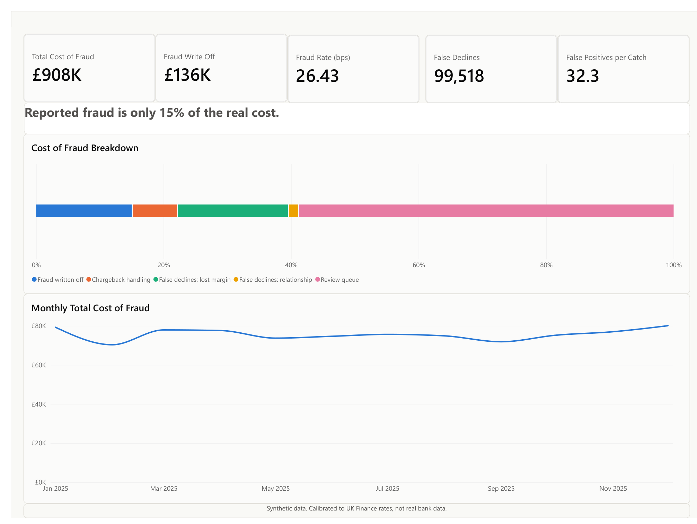
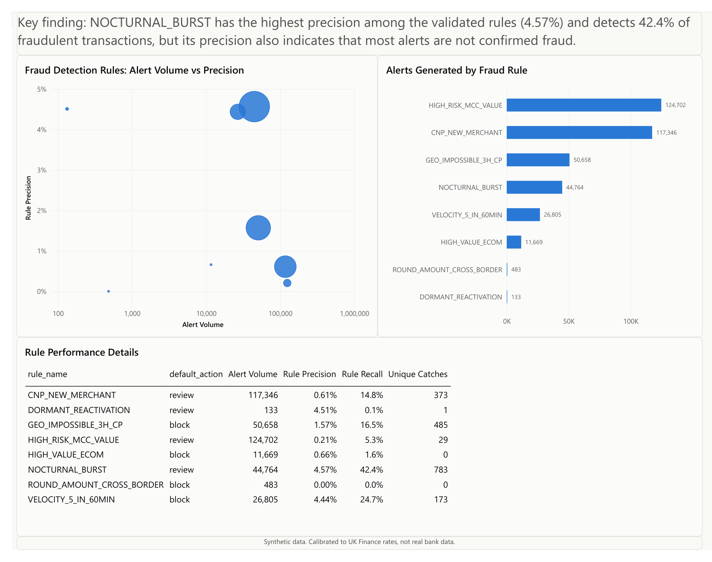

# Power BI report: Card Fraud and Disputes

The same analysis as the [live HTML dashboard](https://onyekaogbonna.com/dashboards/card-fraud/), rebuilt natively in Power BI Desktop. All data is synthetic, calibrated to UK Finance rates. It is not real bank data.

**Report PDF:** [`card-fraud-disputes-report.pdf`](card-fraud-disputes-report.pdf) (5 pages)

## The five pages

| | |
|---|---|
| **Executive** | Total cost of fraud, and why the reported figure (the write-off) is only 15% of it. |
| **Rule performance** | Precision, recall and unique catches for the eight detection rules, on a log-scale scatter. |
| **Fraud patterns** | Fraud rate (bps) by hour and channel, merchant category and amount band, with transaction volumes alongside so thin cells are not over-read. |
| **Customer impact** | False decline rate by segment and channel, and the measured effect on later spend. |
| **Scenarios** | Cost and fraud-loss guardrail for four rule configurations. Recommended: constrained retuning. |

## What this shows

- **Star schema.** Two fact tables (2.4m transactions, 377k alerts) with customer, merchant, rule and date dimensions. No bi-directional filtering, because a transaction can fire several rules.
- **DAX.** About 40 measures in [`measures.dax`](measures.dax): detection outcomes, rule precision and recall, the five-part cost model, and a disconnected table for the cost breakdown.
- **Reconciliation.** Measures are checked against figures computed separately in SQL ([`data/expected_values.csv`](data/expected_values.csv)). Total cost of fraud in Power BI is **GBP 907,714**. The project's Python scenario simulator reports a baseline of GBP 909,144 because it re-simulates analyst decisions instead of using the observed outcome. The 0.16% gap is documented on the Scenarios page.
- **Honest limits.** The -8.1% change in later spend comes from a matched analysis in Python, and a placebo test returns +11.3%, so it is shown as indicative, not proven. Scenario results come from the Python simulator and are not recalculated in DAX.

## Rebuild it

1. Generate the data by running the scripts in `src/` (see the main README), then `python powerbi/export_powerbi_data.py`. This writes the import-ready tables to `powerbi/data/` (not committed, about 70 MB).
2. Follow [`BUILD_GUIDE.md`](BUILD_GUIDE.md): load, relationships, measures, five pages.
3. Apply [`theme_analystkit.json`](theme_analystkit.json).

## The .pbix file

Download `card-fraud-disputes-powerbi-v1.0.0.pbix` from the [GitHub release v1.0.0](https://github.com/codewithkachi/card-fraud-disputes/releases/tag/powerbi-v1.0.0). It is about 111 MB with the data embedded, which is over GitHub's 100 MB file limit, so it is a release asset and not in the repository. Open it in Power BI Desktop (Windows). SHA-256: `463a7610767575f7ae67858849e4271e92064c3160856ea0cc2df8469daefbdb`.

You can also rebuild it from the steps above.
